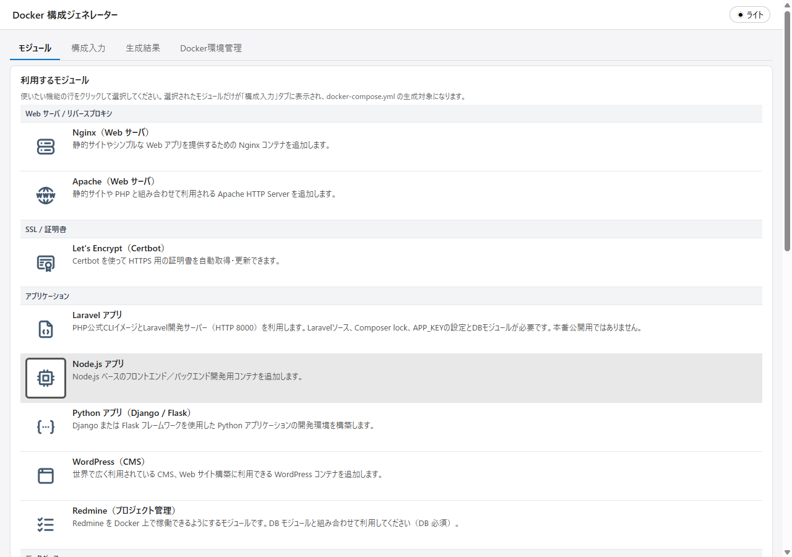
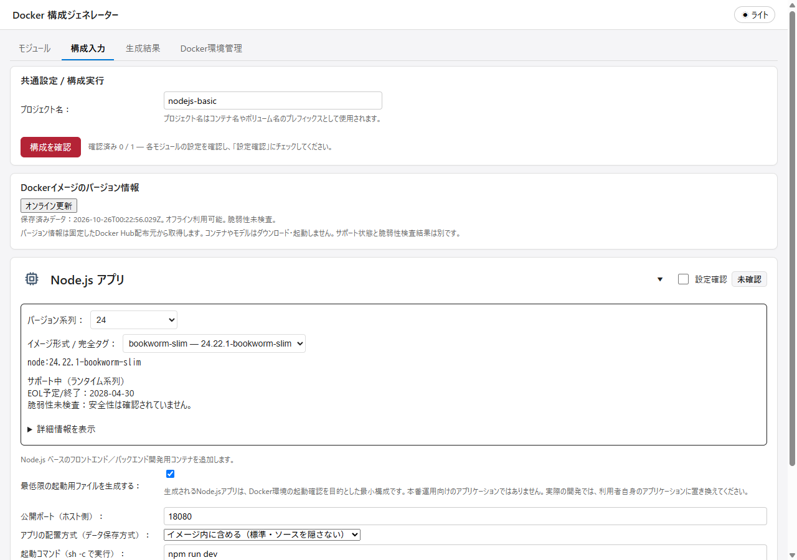
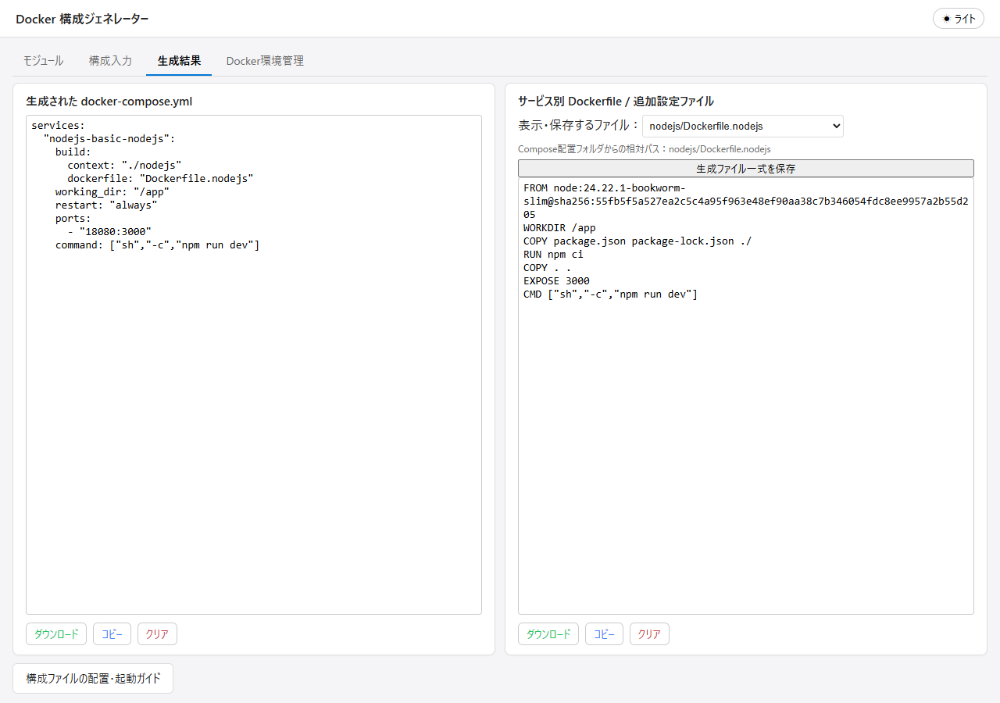
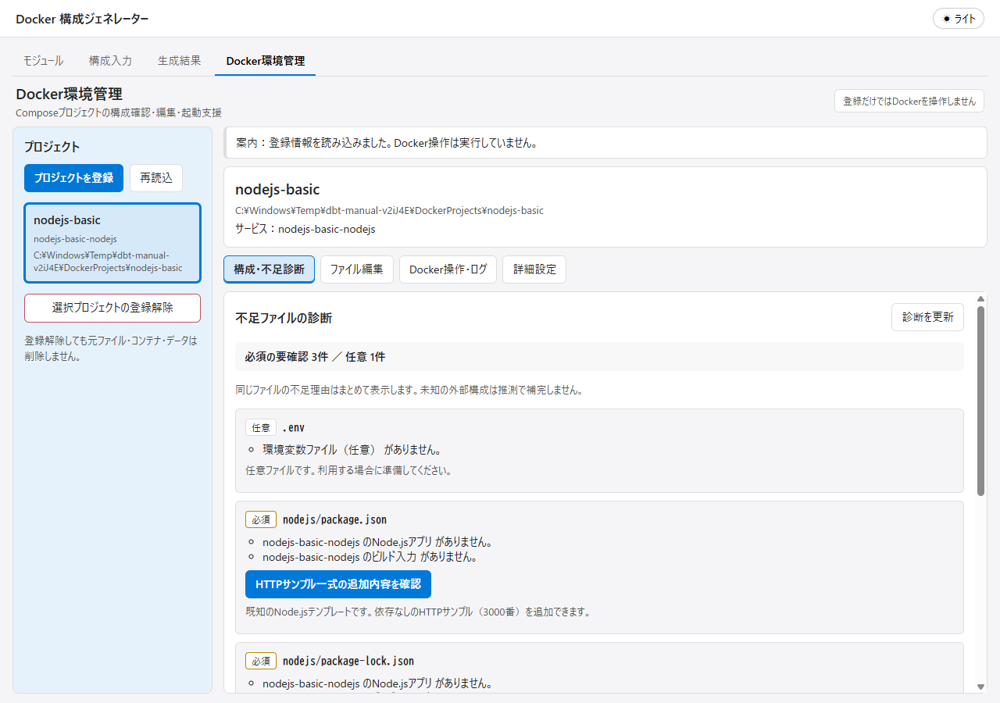

# Server Control Studio

Docker Composeの構成ファイルをGUIで生成し、保存済みComposeプロジェクトの構築を支援する **Electron製デスクトップツール** です。

複数のミドルウェア（Web / DB / Cache / 管理ツール等）を選択し、docker-compose.yml を組み立てる用途を想定しています。

操作方法は[操作マニュアル](docs/manual/index.html)、構成例は[レシピ集](docs/manual/recipes.html)をご覧ください。開発・検証記録と旧資料は `docs/OLD/` に保管しています。

正式公開版は [v0.1.0](https://github.com/qtaro-dev/Server-Control-Studio/releases/tag/v0.1.0) です。アプリ内のバージョン表示はパッケージ情報に基づきます。開発ソースから試す場合は、以下の起動手順を参照してください。

生成のみならローカルDockerは不要です。管理タブから実際にビルド・起動するには、Docker CLI・Compose v2と接続可能なDocker Engineが必要です。WindowsではDocker Desktop（WSL 2方式、Linuxコンテナ）を起動しておきます。開発用の[Docker検証CI](docs/OLD/docker-validation-ci.md)はGitHub-hosted runnerで実行する別の仕組みです。

アプリ本体にはGitHub認証・トークン管理・生成物の送信・Actions起動を追加しません。[GitHub非連携方針と調査結果](docs/OLD/github-integration-policy.md)を参照してください。開発用CIとDocker Hub更新は維持します。

---

## 概要

Docker 構成ファイルを手動で記述する手間を削減し、
GUI 操作で再利用可能な docker-compose.yml を生成できることを目的としたツールです。

Docker 初学者や検証環境を素早く構築したいユーザー向けに、
モジュール選択方式で構成を組み立てられる設計になっています。

---

## 主な機能

* Electron によるクロスプラットフォーム対応デスクトップアプリ
* モジュール選択式 UI

  * Nginx / Apache
  * MySQL / MariaDB / PostgreSQL
  * Redis / Memcached
  * WordPress / Redmine / Jenkins
  * Portainer / phpMyAdmin
  * Ollama など
* 選択したモジュール構成から docker-compose.yml を自動生成
* サービス別Dockerfile、Nginx・Apacheの初期HTMLや設定ファイルを生成
* プロジェクト名のフォルダへ生成ファイル一式を保存（同名時は確認・別名保存・キャンセル）
* **Docker環境管理** — 既存Composeの登録、不足診断、限定的なNode.js HTTPサンプル補完、ファイル編集・差分確認・バックアップ
* **Docker基本操作** — 接続確認、構成検証、起動・停止・再起動、ビルド・再構築、稼働状態・ログ取得
* UI 設定（テーマ切り替えなど）
* モジュールは JS ファイル単位で追加・管理可能（拡張性を考慮した設計）

---

## 設計思想

* 手動で docker-compose を記述する負担を軽減
* 検証環境の迅速な立ち上げを支援
* モジュール単位で構成を管理し、拡張しやすいアーキテクチャを採用
* GUI ベースで視覚的に構成を理解できる設計

---

## 技術構成

* Electron
* JavaScript (ES6)
* HTML / CSS
* Node.js
* Docker Engine / Compose v2（管理タブから操作する場合に必要）

---

## ディレクトリ構成（抜粋）

```
app/
├─ index.html
├─ management/  # Docker環境管理
└─ src/
   ├─ renderer/
   ├─ modules/
   ├─ img/
   └─ style.css
main.js
preload.js
package.json
docs/manual/   # オフライン操作マニュアル・レシピ
```

---

## 起動方法（開発用）

```bash
node tools/npm/bootstrap.cjs
node tools/npm/run.cjs ci
node tools/npm/run.cjs start
```

Node.jsの要件は`package.json`、CIで使用する版は`.node-version`を参照してください。npmは`tools/npm/toolchain.json`で固定し、プロジェクト内の`.tools`へ導入します。PC全体のNode.js・npmは変更しません。専用npmがない・版が違う場合は停止し、グローバルnpmへは切り替えません。[専用npmの開発・テスト・ビルド手順](tools/npm/README.md)を参照してください。既存の3タブに加え「Docker環境管理」を表示します。

## 最初の構築手順（Node.jsのHTTP確認例）

1. 「モジュール」で「Node.js アプリ」を選択し、「構成入力」でプロジェクト名を`nodejs-basic`にします。
2. 公開ポートを空きTCPポート（例：18080）にし、「最低限の起動用ファイルを生成する」をONのまま、既定のDockerfile・起動コマンドを使います。「設定確認」にチェックして「構成を実行」を押します。
3. 「生成結果」→「生成ファイル一式を保存」で親フォルダを選びます。その直下の`nodejs-basic/`にCompose・Dockerfile・Node.jsのpackage.json/lock/server.cjsが保存されます。初期位置は設定の「プロジェクトフォルダ」です。保存先例はドキュメントの`DockerProjects`です。OneDrive等によって実際のドキュメントの場所は異なる場合があり、任意の保存先も選べます。
4. 「Docker環境管理」→「プロジェクトを登録」で保存した`docker-compose.yml`を選びます。登録だけではDockerを実行しません。
5. 「構成・不足診断」を確認します。初期生成ONなら起動確認用アプリが既に保存されています。初期生成OFFで既知のNode.js用ファイルが不足している場合は、「HTTPサンプル一式の追加内容を確認」から補完できます。どちらも**動作確認専用の最小HTTPアプリ**で、本番アプリの自動生成ではありません。既存のアプリファイルを推測して置き換えません。
6. 「詳細設定」で実行名・Context（Windows初期値は`desktop-linux`）・Compose順序を確認します。
7. 「Docker操作・ログ」で「Engine接続確認」→「構成検証」→「起動」を実行します。起動時の対象確認を読み、信頼する構成だけ承認してください。
8. 「稼働状態」とブラウザの`http://localhost:18080/`で、`Server Control Studio Node.js startup OK`（管理画面の補完サンプルは`Server Control Studio HTTP sample OK`）を確認します。終了時は「停止」を使います。

各操作の実画面と編集・バックアップ手順は[Docker環境管理の操作ガイド](docs/manual/index.html#management)に掲載しています。「再起動」は既存コンテナのrestart、「再構築」はキャッシュなしのbuildです。ビルド後の反映には「起動」を行います。ログ取得は末尾150行で、常時追尾ではありません。

## Compose・管理機能の範囲

- 新規生成Composeは`services:`から始まり、obsolete扱いのトップレベル`version`属性を出力しません。既存ユーザーファイルや登録した外部Composeは自動変換しません。
- 外部Composeも登録できます。同時登録するComposeは同じ親フォルダ内の最大10件で、詳細設定から順序・実行名・Context・プロジェクト内の.envを指定できます。登録情報は次回起動時にも保持します。
- 編集対象はプロジェクト内で診断された通常ファイルです。保存前の差分確認とバックアップを行い、ComposeはDocker構成検証成功後に保存します。バックアップ先はアプリのuserData内`compose-management/backups/`で、保存後に実際のパスを表示します。自動復元ボタンはありません。
- .env・秘密鍵・機密行の編集、任意シェルコマンド、ボリューム削除、Docker全体の管理・常時監視は対象外です。未知の外部構成、外部パス、動的参照を完全に診断・補完する機能ではありません。
- 「選択プロジェクトの登録解除」は一覧からの除外だけです。コンテナ停止・ファイル削除・DBデータ削除は行いません。

検証は`npm test`、`npm run test:electron`で実行できます。Electron UI試験の模擬Docker応答と実Docker検証は区別しています。開発者向けの制約・検証記録は[管理機能の開発記録](tools/management/README.md)を参照してください。

---

## Screenshots

### モジュール選択



### モジュール設定入力画面



### 生成結果画面



### Docker環境管理



---

## 今後の拡張予定（例）

* テンプレート保存機能
* バリデーション強化
* 生成前の構成プレビュー表示
* クラウド環境向け設定プリセット対応

---

## 開発背景

Docker 構成を GUI で生成できるツールがあれば、
検証環境構築や学習用途に有用であると考え開発。

当初はC#で開発を試みたが、UI変更の柔軟性や試行錯誤の速度を重視し、Electronへ移行。
フロントエンド技術を活かしたレイヤー設計を採用した。

個人開発プロジェクトとして設計・実装を行っています。

## 配布方針

本プロジェクトの自作ソースコードと自作サンプルコードは [MITライセンス](LICENSE.txt) で公開します。利用・改変・再配布が可能です。画像、第三者コード・ライブラリ、商標には個別の条件が適用されます。詳しくは [第三者著作権表示](THIRD_PARTY_NOTICES.txt) を参照してください。

Windows x64のInstaller版・Portable版は、[GitHub Releases](https://github.com/qtaro-dev/Server-Control-Studio/releases/tag/v0.1.0) から無料で入手できます。未署名のEXEは、Windows SmartScreen等が警告を表示する場合があります。ダウンロードしたファイルは公開時のSHA-256と照合してください。

Server Control StudioはDocker, Inc.と提携していない独立したプロジェクトです。

## 開発環境（Server Control Studio）

初回は `node tools/npm/bootstrap.cjs` と `node tools/npm/run.cjs ci` を実行します。以後は通常のPowerShellで `npm start` を実行できます。起動時は専用npmとインストール済み依存の整合性を検査します。依存の変更・監査・テスト・ビルドには `node tools/npm/run.cjs <コマンド>` を使用してください。グローバルNode.js/npmやシステムPATHは変更しません。設定はServer Control Studioの保存先から読み込みます。
